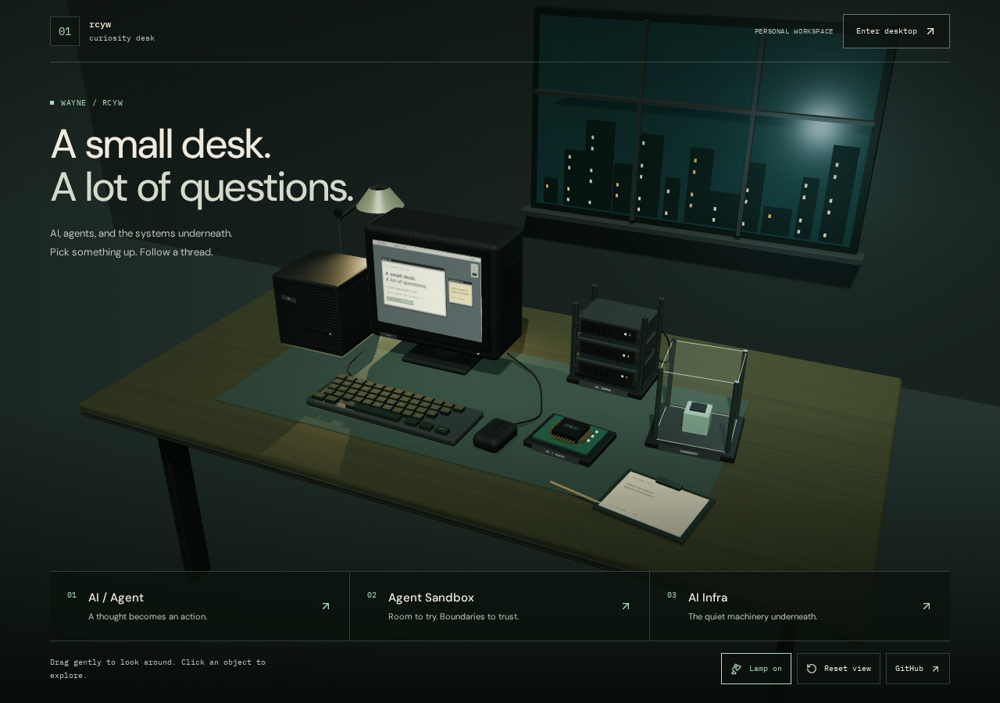

# Hi, I'm Wayne

Also known as **rcyw**. Curious about AI agents, the spaces they work in, and the systems that keep them running.

**[Step into my curiosity desk →](https://rcyw.github.io/)**

Switch on a lamp, look around, and follow a thread:

- **AI / Agent** — What makes an agent useful beyond a good demo?
- **Agent Sandbox** — How can agents explore within boundaries we can trust?
- **AI Infra** — What makes all of this reliable enough to build on?

If you're exploring similar questions, I'd be glad to compare notes, trade a useful link, or hear a different approach.

[Find me on GitHub](https://github.com/rcyw)
